# Capturas del Trabajo Práctico Final

Este documento reúne las capturas disponibles del funcionamiento de la aplicación y de sus interfaces.

## 1. Pruebas de API en Postman

### Login

**Login exitoso**

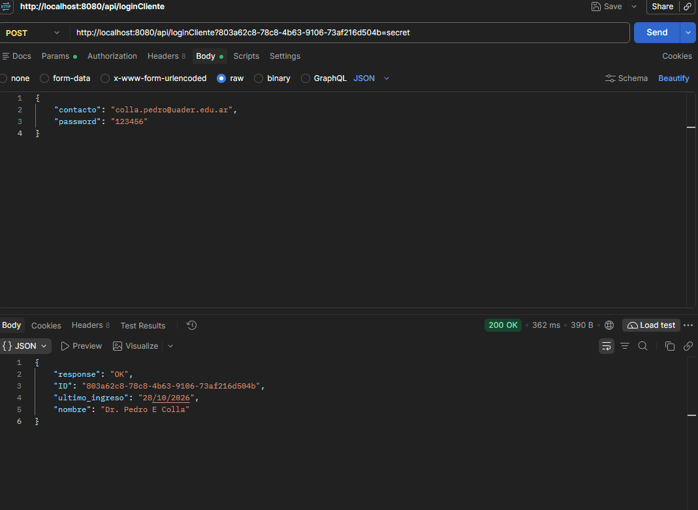

**Login con error**

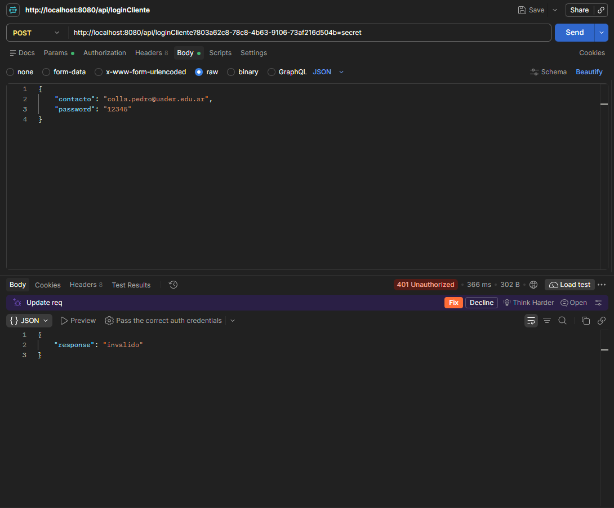

### Registro

**Registro exitoso**

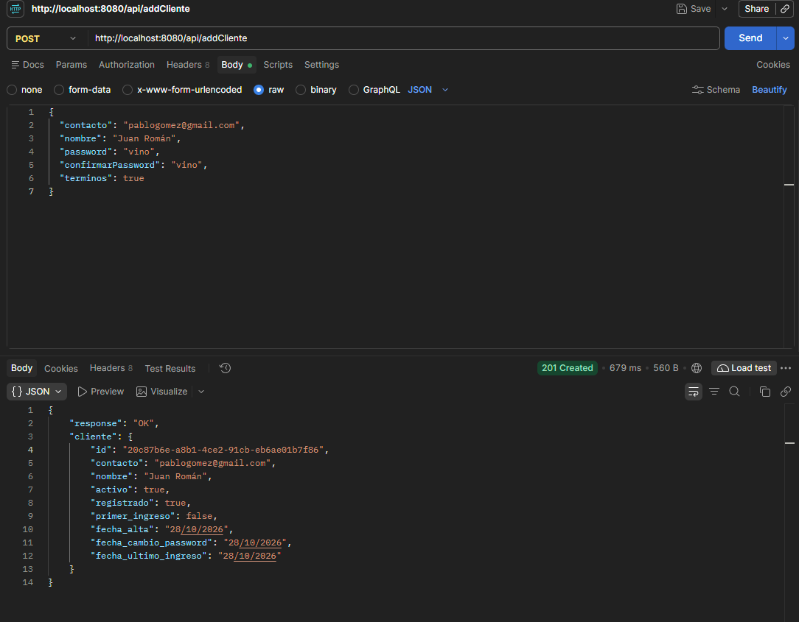

**Registro con error**

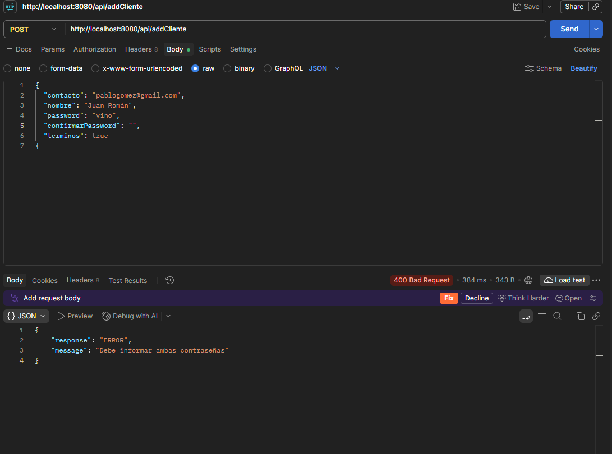

### Tickets

**Consulta de ticket (GET)**

**Solicitud de ticket (POST)**

**Error de credenciales**

**Error de ticket**

### Resumen de tickets

**Resumen de tickets (POST)**

**Consulta del resumen de tickets (GET)**

**Error al consultar el resumen**

## 2. Interfaces de usuario (UX/UI)

### Login

**Inicio de sesión exitoso**

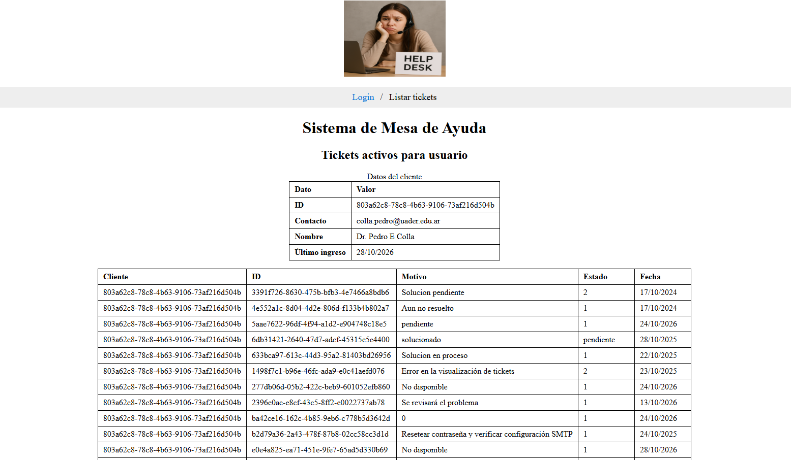

**Inicio de sesión con error**

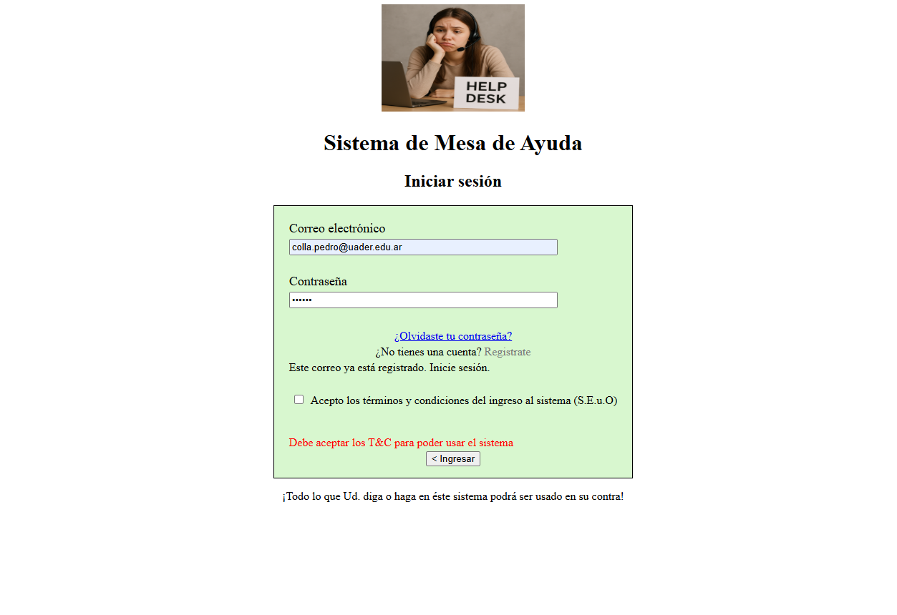

### Registro

**Registro exitoso**

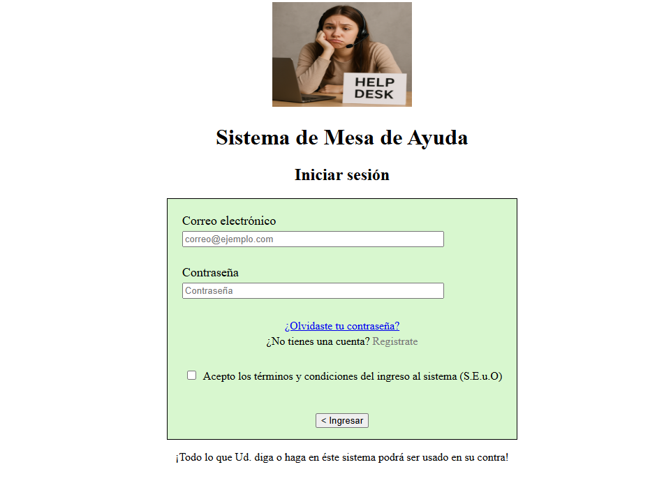

**Intento de registro con correo existente**

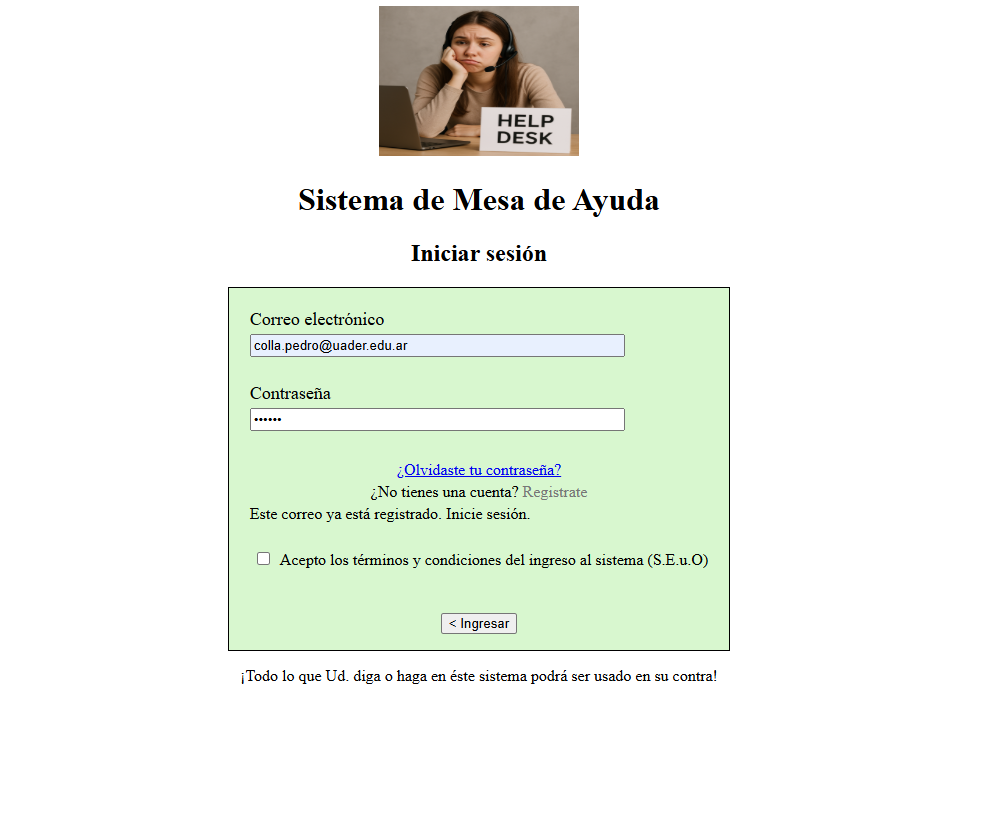

**Registro bloqueado por contraseñas distintas**

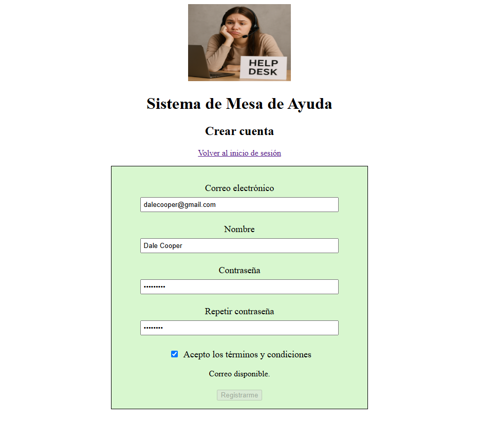

**Inicio de sesión con el nuevo cliente**

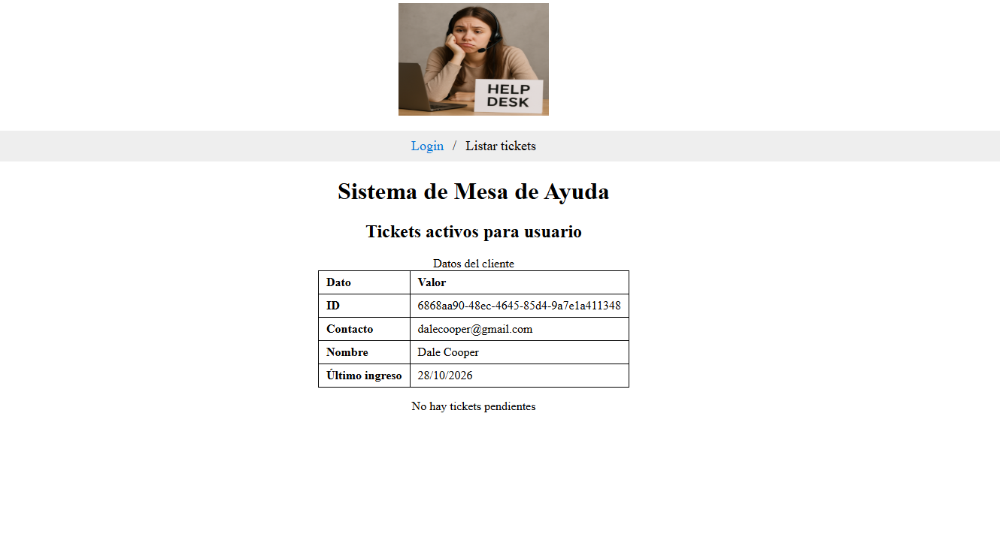

### Cambio de contraseña

**Cambio de contraseña exitoso**

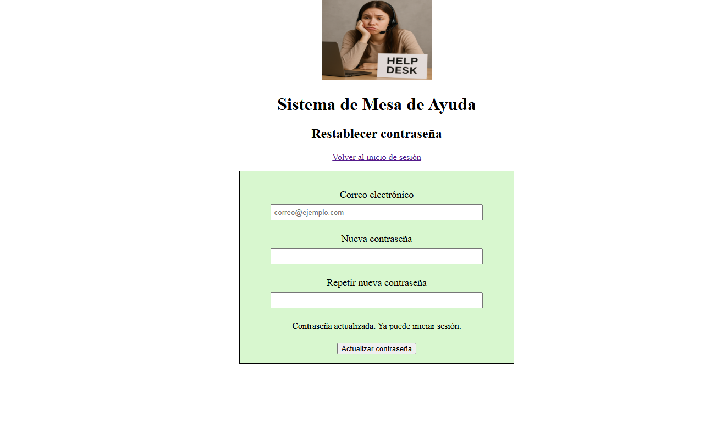

**Cambio de contraseña con error**

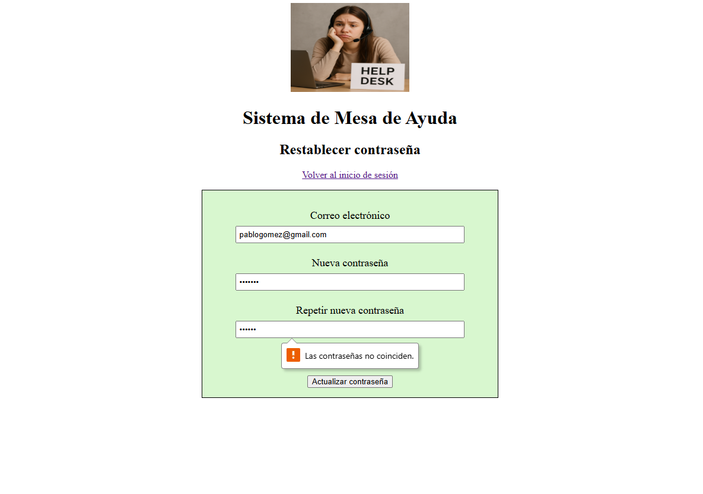
